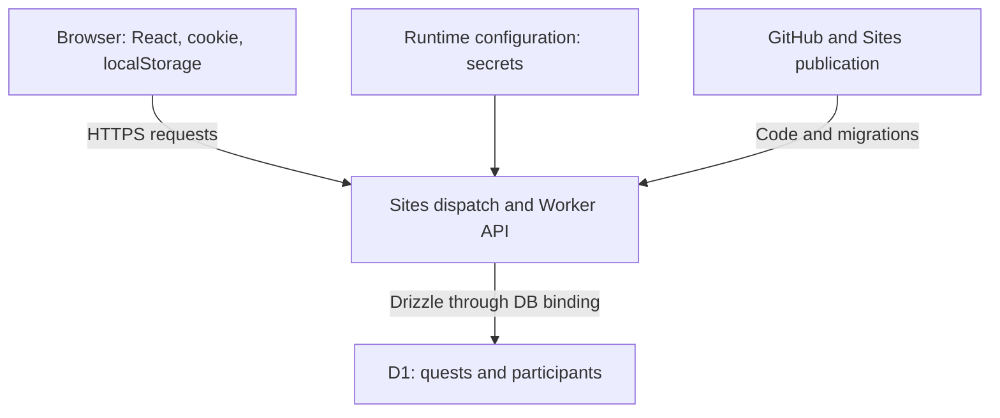
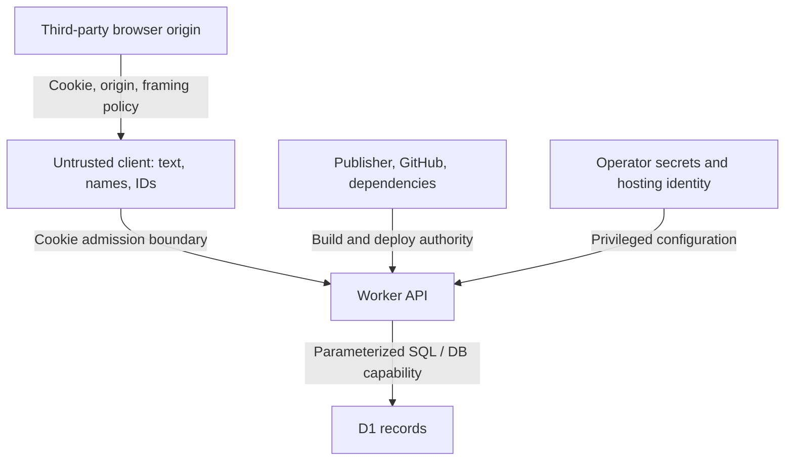

# Side Quest Ledger

A shared quest board for small adventures, creative challenges, and reasons to leave the house.

Live site: https://side-quest-ledger.dreamycedar64.chatgpt.site

## Features

- Multiple people can join the same quest with independent completion status.
- A one-time name prompt remembers the visitor in browser localStorage.
- New quests record and display their creator.
- Categories, rewards, XP, and active/completed filters.
- Shared password access and an aubergine/teal interface.

## Stack

React, TypeScript, Vinext/Vite, Cloudflare Workers, D1, and Drizzle.

<!-- BEGIN GENERATED:SCOPE -->

## Scope and system boundary

Generated from the [formal model](docs/FORMAL_MODEL.md#1-scope-and-system-boundary).

The product is one shared board. Visitors unlock it with a shared key, choose a display name, create quests, and independently participate in quests. Completion earns a computed score; there is no wallet, payment, prize settlement, social-network integration, notification service, or AI agent in the running product. Repository coding agents are a separate development concern.



The browser renders the interface and caches a snapshot in React memory. The Worker executes server handlers. D1 is durable structured storage, accessed through `env.DB`; it is not a repository database file. The hosting manifest declares `d1: "DB"` and no R2 binding. GitHub contains code and schema, not the live board's records or runtime secrets.

<!-- END GENERATED:SCOPE -->

<!-- BEGIN GENERATED:THREATS -->

## Security boundaries

Generated from the [threat model](docs/THREAT_MODEL.md#4-trust-boundaries-and-attack-surface). This diagram shows the boundaries where client input, admission credentials, database access, and publication authority must be controlled.



<!-- END GENERATED:THREATS -->

## Development

Requires Node.js 22.13 or newer and pnpm.

```sh
pnpm install
pnpm dev
```

Configure `SITE_PASSWORD` and `SESSION_SECRET` as runtime environment variables. Keep their values out of Git. The D1 binding is `DB`; schema and migrations live in `db/` and `drizzle/`.

```sh
pnpm db:generate
pnpm build
```

The project retains its Sites hosting manifest and build integration. Local database migrations and production publication are separate operations; hosting applies committed migrations during deployment.

Generated archives, dependency folders, environment files, and local runtime state are excluded from this repository.

## Engineering documentation

- [State of the union](STATE_OF_THE_UNION.md): implemented features, deployment provenance, evidence, and open decisions.
- [Formal system model](docs/FORMAL_MODEL.md): architecture, data, API transitions, invariants, failures, and proposed ownership model.
- [Threat model](docs/THREAT_MODEL.md): trust boundaries, ranked risks, mitigations, and security acceptance criteria.
- [Changelog](CHANGELOG.md): delivered changes and publication history.
- [Agent instructions](AGENTS.md): codebase constraints and decision provenance.
- [Executable model](docs/model/README.md): offline state exploration and expected security counterexamples.

The current app is a shared-access prototype, not a hardened multi-user security boundary. Display names do not establish individual identity or ownership. Read the threat model before using it for sensitive data or expanding access.

## Keeping the README current

The scope section and diagrams above are generated from the canonical model documents. Edit those documents, then run `pnpm docs:sync`; use `pnpm docs:check` to detect drift. Do not edit generated README blocks directly. GitHub checks pull requests and automatically regenerates the README after relevant changes reach `main`, provided Actions and its write permission are enabled. A failed synchronization run requires attention; it is not a guarantee that stale content can never be committed.
