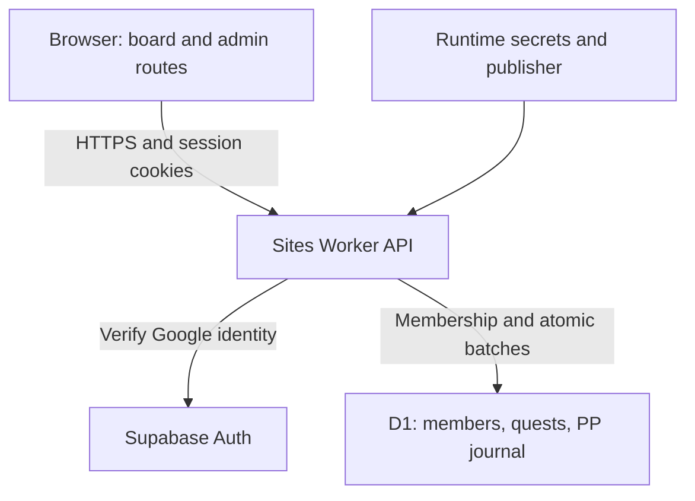
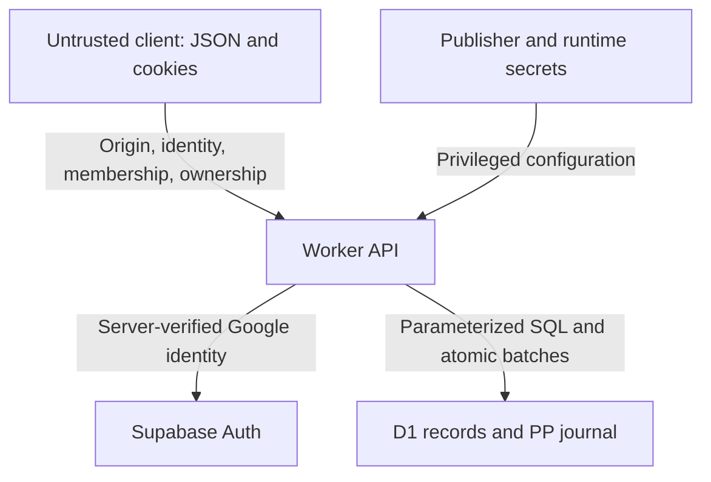

# Side Quest Ledger

The one-page entry screen uses two approved mint-teal-on-aubergine engravings. Sign-in shows the compass, elephant key fob, and floating mountain path with the added bent-over figures (`public/quest-signin.webp`). Group registration shows Swab welcoming Myles and friends through a Seattle gateway, Parekh on his shoulder, the “Dr. Goovinson” backpack, Arabic moon inscription, and small Cancer glyph (`public/quest-group-check.webp`). The group artwork appears both before the questions are requested and while answering them. Both images retain the existing responsive square frame and are optimized as WebP at their original 1254×1254 resolution. The header credits Panoptic Engineering; footer icons remain aligned, and the canvas stays aubergine during overscroll. Barlow Condensed is self-hosted under its included SIL Open Font License in `public/fonts/`.

A friends-only board with Supabase Google identity, Power Points, staked quests, two-person peer review, a member market, tips, Kudos, memories, and admin recovery.

See [MEMBER_RELEASE.md](MEMBER_RELEASE.md) for current behavior, required live configuration, and validation. The member release is live with Supabase Google and exact callbacks configured. Real-user enrollment remains unverified; see [GOOGLE_AUTH_SETUP.md](GOOGLE_AUTH_SETUP.md). The latest batch adds quest editing, revision-checked commitments, listing edits/restocking, protected checkout, and admin reviewer replacement. It passes 128 domain checks, TypeScript, and the production build; deployment details are in MEMBER_RELEASE.md. Photo storage is disabled to honor the strict $0 requirement.

Admin controls live at `/admin`, with an entry link visible only to the configured owner. The main board does not load admin data. Registration grants admin only to the configured verified Google email; server checks protect dashboard reads and every admin action. Run `node scripts/test-authorization.mjs` for owner-role edge cases.

<!-- BEGIN GENERATED:SCOPE -->

## Scope and system boundary

Generated from the [formal model](docs/FORMAL_MODEL.md#1-scope-and-system-boundary).

The product is a friends-only quest board with verified Google identity through Supabase Auth, server-side group enrollment, durable member ownership, Power Points (PP), two-person completion review, a member market, tips, Kudos, memories, and an owner-only `/admin` dashboard. PP is an in-app point balance, not a real-money payment service. Quick capture, chat automation, and notification delivery are not included.



Supabase owns authentication; D1 under the existing `DB` binding stores application records. The browser supplies requested actions, never actor authority. The Worker verifies identity, active membership, owner permissions, and admin policy. Display names are labels. The hosting manifest retains its Site identity and `r2: null`; photo storage and object I/O remain disabled. GitHub holds application source and migrations, not runtime secrets, live data, or generated deployment archives. GitHub and Sites have separate histories and publication steps.

Account deletion (October 21, 2026): authenticated members can close their own account with typed confirmation. An atomic D1 closure anonymizes structured identity, archives owned items and retires unused PP through compensating events. A caller-authenticated Supabase Edge Function checks the fixed Worker readiness endpoint, revokes sessions and removes only its validated caller. Pending obligations prevent closure. Shared history remains; a secret email HMAC prevents repeat starter grants. Provider failures expose an idempotent finish-deletion state. See [ACCOUNT_DELETION.md](../ACCOUNT_DELETION.md) for exact retention and verification limits.

### Current release semantics

- First enrollment creates one member and one 100 PP welcome event; rejoining after deletion with the same normalized verified email receives no additional grant. Enrollment completes after a three-question server challenge. Admin registration is restricted to the configured verified Google email; there is no first-user-admin rule.
- Funded quests reserve 10–35 PP. An insufficient balance instead produces a 20 PP quest and a 20 PP debit, allowing debt. The first completion approved by both independent randomly assigned reviewers wins the pot; later completions may be verified without a second payout.
- Interest and commitment are distinct. A reported scheduled no-show requires an admin-confirmed 10 PP fee. The submitter and quest owner are excluded from reviewer selection; fewer than two eligible reviewers leaves a submission waiting.
- Tips and market reservations cannot normally overdraw. Purchases reserve PP until fulfillment/receipt, with cancellation/refund and audited admin recovery. Immutable journal events drive wallet balances; reversals append compensation.
- Owner edits use revision checks. Commitments and checkout reject stale offers; listing restocks are additive. Soft deletion retains history and supports restoration. Legacy name-only attribution remains unowned until an audited assignment.
- `/admin` has its own route. Admin data and mutations require server authorization: stored admin role, stored member email, and current verified Google email must match the configured owner. The member board does not fetch admin data.
- Requests enforce same-origin JSON mutations, bounded bodies/fields/results, rate counters, and idempotency keys. These controls and local tests are not a complete production security assessment.

The 128 domain/migration/permission/accounting checks, 12 owner-authorization checks, 11 local API boundary checks, TypeScript, and production build passed. Browser checks used isolated synthetic users; the live owner dashboard was observed read-only. Multi-user production review/market flows, session revocation guarantees, load capacity, and disaster recovery remain unverified. See [MEMBER_RELEASE.md](../MEMBER_RELEASE.md) for exact rules and limits.

<!-- END GENERATED:SCOPE -->

<!-- BEGIN GENERATED:THREATS -->

## Security boundaries

Generated from the [threat model](docs/THREAT_MODEL.md#4-trust-boundaries-and-attack-surface). This diagram shows the boundaries where client input, admission credentials, database access, and publication authority must be controlled.



<!-- END GENERATED:THREATS -->

See [STATE_OF_THE_UNION.md](STATE_OF_THE_UNION.md), [formal model](docs/FORMAL_MODEL.md), and [threat model](docs/THREAT_MODEL.md) for current scope, historical evidence, and verification limits. Generated sections are maintained with `pnpm docs:sync` and `pnpm docs:check`.

The starter reference below describes infrastructure rather than the app's active identity provider.

Account settings include self-service deletion for testing Google sign-in and group enrollment again. Shared history is retained as “Deleted member”; repeat registration does not issue another starter grant. See [ACCOUNT_DELETION.md](ACCOUNT_DELETION.md) for behavior, configuration, retries, and checks.

## Starter infrastructure reference

## Prerequisites

- Node.js `>=22.13.0`
- Portable: Windows, macOS, or Linux; no Bash required
- Managed Linux: managed Linux runtime with Bash, `flock`, `curl`, `sha256sum`, and GNU `timeout`
- Git is required only for publishing

## Sites Lifecycle

The Sites initializer copies the shared starter and selects managed-linux only when `SITES_MANAGED_LINUX_CONTAINER=1`; otherwise it selects portable. It saves the selection only in ignored `.sites-runtime/execution-profile.json`. Both profiles copy/configure first, then use the plugin's separate `install-dependencies.mjs` step to measure installation independently. Edit source under `app/` and follow the Sites skill for installation, preview, builds, and publishing.

Run `node <plugin-root>/scripts/configure-execution-profile.mjs` only when the profile is unknown for the current checkout and environment. Profile changes do not alter tracked source or require reinstalling otherwise-valid dependencies; restart an existing preview to use the new selection. Do not commit or upload `.sites-runtime/`.

This starter does not use `wrangler.jsonc`.

`install:ci` runs `npm ci` once against the shared lockfile, disables parent-workspace discovery, and includes required dev/optional dependencies despite production/omit settings. Sharp defaults to prebuilt binaries unless explicitly configured otherwise. Do not overlap installers.

- **Portable:** Preserve host HOME, npm cache, registry, proxy, temporary paths, retry/concurrency settings, and lifecycle-script policy. Use `--prefer-offline --no-audit --no-fund`.
- **Managed Linux:** Use the existing project-local HOME/cache/tmp setup and Linux install lock, tarball preflight, and timeout. Restore the image-seeded npm cache only when its lockfile hash matches; retain network fallback. Builds keep their existing timeout. These helpers are not invoked by the portable profile.

`scripts/sites-env.mjs` preserves the caller's HOME, npm cache, proxy, XDG, and temporary-directory configuration while defaulting Wrangler and Miniflare state to the checkout. If npm reports an unwritable cache, select a writable path with `npm_config_cache` for that install. The `dev` and `start` scripts also keep Wrangler logs inside the checkout. Generated `.sites-runtime/` and `.wrangler/` directories are disposable and ignored by Git.

On portable, `npm run dev` uses `vinext dev` with HMR, starting at port 5173. Vinext records the running server in ignored `.vinext/` state, rejects an ordinary duplicate launch, and recovers stale state after a stopped process; exactly simultaneous starts can race. Pass `--port <port>` or `--hostname <host>` after `npm run dev --` when needed; keep portable previews on loopback.

For browser QA on managed Linux, use `sites-preview start`. The project's dev script runs Vite and accepts the supervisor's `--host 0.0.0.0 --port 4173 --strictPort` arguments. The internal browser uses `http://terminal.local:4173/`; it is not a user-facing URL. The supervisor owns the preview lifecycle. The ignored local profile survives the supervisor's cleared process environment.

The portable profile simulates ChatGPT sign-in only for loopback development requests. Visit `/signin-with-chatgpt?return_to=/` to sign in as `local_seedy` (`seedy@sites.test`, display name `Seedy`) and `/signout-with-chatgpt?return_to=/` to sign out. The development cookie preserves that identity across server restarts. Mock auth is disabled in the managed-linux profile and is not included in production builds; hosted authentication remains dispatch-owned.

The Worker uses `vinext/server/fetch-handler`, including Vinext's config-aware image handling. After building, `npm start` runs that Worker locally through Wrangler on `127.0.0.1`, sharing `.wrangler/state` with dev preview and local D1 migrations; it does not deploy the site or simulate sign-in. Use the URL printed by the server. Pass `npm start -- --port <port>` to select a different built-preview port.

Local previews use Miniflare's placeholder `Request.cf` metadata without a network lookup. Set `CLOUDFLARE_CF_FETCH_ENABLED=true` to opt into fetching preview metadata; this setting does not change hosted request metadata.

Local tool usage metrics are disabled by default. Set `WRANGLER_SEND_METRICS=true` to opt in.

## Included Shape

- edit site code under `app/`
- `app/chatgpt-auth.ts` provides optional dispatch-owned ChatGPT sign-in helpers
- `.openai/hosting.json` declares optional Sites D1 and R2 bindings
- `vite.config.ts` simulates declared bindings for local development
- `db/index.ts` reads the D1 binding from the Cloudflare Worker environment
- `db/schema.ts` starts intentionally empty
- `@cloudflare/workers-types` provides Worker types; `cloudflare-env.d.ts` declares optional `DB`/`BUCKET` bindings—update these declarations if binding names change
- `examples/d1/` contains an optional D1 example surface
- `drizzle.config.ts` supports local migration generation when needed

## Workspace Auth Headers

Signed-in visitors receive both `oai-authenticated-user-id` and `oai-authenticated-user-email`. Private Sites require every visitor to sign in; public Sites may also have anonymous visitors, for whom neither header is present.

The user ID is stable for the same user on the same Site and different across Sites. Use it as the durable user key; use email and name for display or contact purposes.

SIWC-authenticated workspace sites may also receive `oai-authenticated-user-full-name` when the user's SIWC profile has a non-empty `name` claim. The full-name value is percent-encoded UTF-8 and is accompanied by `oai-authenticated-user-full-name-encoding: percent-encoded-utf-8`.

Treat the full name as optional and fall back to email when it is absent:

```tsx
import { headers } from "next/headers";

export default async function Home() {
  const requestHeaders = await headers();
  const userId = requestHeaders.get("oai-authenticated-user-id");
  const email = requestHeaders.get("oai-authenticated-user-email");
  const encodedFullName = requestHeaders.get("oai-authenticated-user-full-name");
  const fullName =
    encodedFullName &&
    requestHeaders.get("oai-authenticated-user-full-name-encoding") ===
      "percent-encoded-utf-8"
      ? decodeURIComponent(encodedFullName)
      : null;

  const displayName = fullName ?? email;
  // ...
}
```

## Optional Dispatch-Owned ChatGPT Sign-In

Import the ready-to-use helpers from `app/chatgpt-auth.ts` when the site needs optional or required ChatGPT sign-in:

- Use `getChatGPTUser()` for optional signed-in UI.
- Use the returned `userId` as the stable user key for user-owned records; do not use email as a durable identifier.
- Use `requireChatGPTUser(returnTo)` for server-rendered pages that should send anonymous visitors through Sign in with ChatGPT.
- In a Server Component, start sign-in with `<a href={chatGPTSignInPath(returnTo)} target="_top">`. The auth helper module is server-only; do not import it into a Client Component.
- Do not use `fetch`, XHR, a client-side router, or a framework link that can prefetch the sign-in route. SIWC must start as a top-level navigation.
- Never request the AuthAPI authorization endpoint directly. The dispatch-owned `/signin-with-chatgpt` route must start the SIWC flow.
- Use `chatGPTSignOutPath(returnTo)` for browser sign-out links or actions.
- Pass a same-origin relative `returnTo` path for the destination after sign-in or sign-out. The helper validates and safely encodes it.
- Mark protected pages with `export const dynamic = "force-dynamic"` because they depend on per-request identity headers.

Dispatch owns `/signin-with-chatgpt`, `/signout-with-chatgpt`, `/callback`, the OAuth cookies, and identity header injection. Do not implement app routes for those reserved paths. Routes that do not import and call the helper remain anonymous-compatible.

SIWC establishes identity only; it does not prove workspace membership. Use the Sites hosting platform's access policy controls for workspace-wide restrictions, or enforce explicit server-side membership or allowlist checks.

Use SIWC for account pages, user-specific dashboards, saved records, and write actions tied to the current ChatGPT user. Leave public content anonymous.

## Local D1 migrations

For a D1-backed local preview, generate SQL with `npm run db:generate`. Build once through the Sites skill's build entrypoint (or `npm run build` for standalone use) to generate `dist/server/wrangler.json`, rebuilding if bindings change. From the project root, apply each pending migration in order:

```sh
node --import ./scripts/sites-env.mjs ./node_modules/wrangler/bin/wrangler.js d1 execute DB --local --config dist/server/wrangler.json --persist-to .wrangler/state --file drizzle/0000_example.sql
```

Replace the filename with the pending migration and `DB` with your D1 binding name if different. Use `.wrangler/state`, not `.wrangler/state/v3`; Wrangler adds the versioned directories. Do not replay migrations already applied locally. This updates only the preview database; publishing applies production migrations separately.

## Diagnostic Commands

- `npm run install:ci`: perform the one locked dependency install
- `npm run dev`: start the Vite/Vinext development server
- `npm run build`: build the deployable Sites artifact
- `npm run start`: preview the built Worker locally with D1/R2 support
- `npm run db:generate`: generate Drizzle migrations after schema changes

When using the Sites plugin, follow its skill instructions for installation, builds, and publishing. These npm commands remain available for standalone use.

The portable build runs Vinext directly without a host `timeout` command. The managed-linux build uses `scripts/build-verified.sh` and its existing `SITES_BUILD_TIMEOUT` setting.

## Learn More

- [vinext Documentation](https://github.com/cloudflare/vinext)
- [Drizzle D1 Guide](https://orm.drizzle.team/docs/get-started/d1-new)
