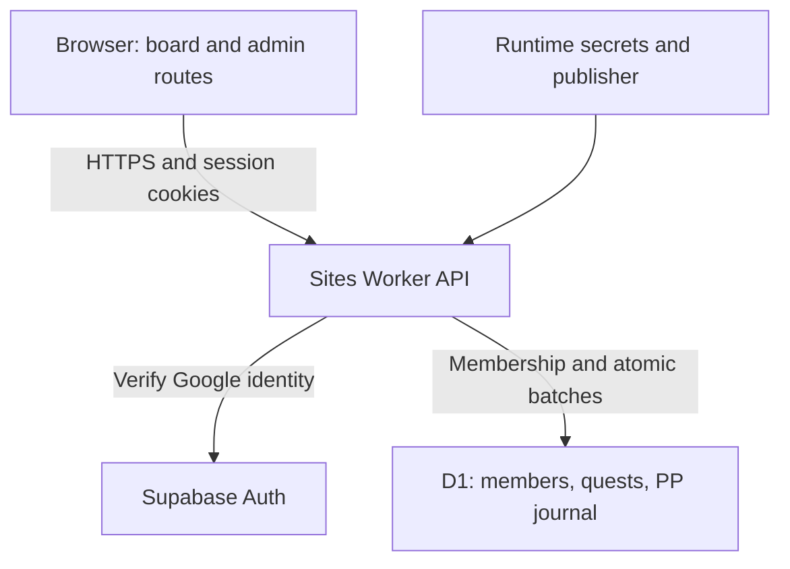
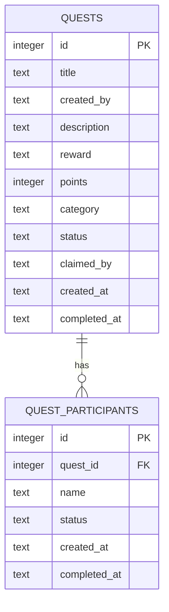
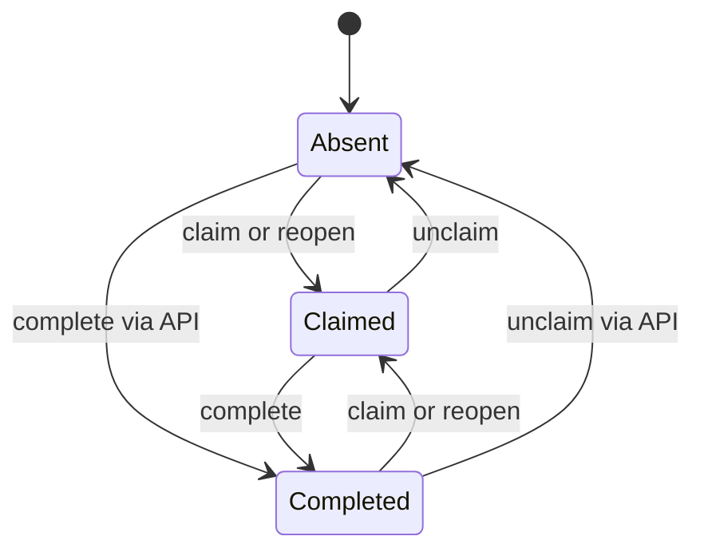

# Side Quest Ledger: formal system model

**Current release:** Sites version 15, source `febf0ca5809b5a12f594aac2b7f80df93abf1942`, deployed October 21, 2026 (Pacific). The scope and release semantics below describe that source. Sections 2–10 retain the October 13 prototype specification as historical evidence and are superseded for current behavior by [MEMBER_RELEASE.md](../MEMBER_RELEASE.md) and the current source. The executable model remains an abstraction of that historical prototype, not verification of the member/PP release.

Historical baseline date: 2026-10-13, America/Los_Angeles. Application source: Sites commit `a64da21e0fd5ab0a1bcd4680220b94c4a7f73610`; equivalent application snapshot in GitHub commit `1c20d8ccad8d9a2608b3ea3ec30c820e1d463f2e`. Documentation does not change runtime behavior.

This specification separates **implemented semantics**, **desired security properties**, and **proposed architecture**. It is a source-based model, not a proof that production satisfies every property. The executable finite-state abstraction and its limits are in [model/README.md](model/README.md).

## 1. Scope and system boundary

The product is a friends-only quest board with verified Google identity through Supabase Auth, server-side group enrollment, durable member ownership, Power Points (PP), two-person completion review, a member market, tips, Kudos, memories, and an owner-only `/admin` dashboard. PP is an in-app point balance, not a real-money payment service. Quick capture, chat automation, and notification delivery are not included.



Supabase owns authentication; D1 under the existing `DB` binding stores application records. The browser supplies requested actions, never actor authority. The Worker verifies identity, active membership, owner permissions, and admin policy. Display names are labels. The hosting manifest retains its Site identity and `r2: null`; photo storage and object I/O remain disabled. GitHub holds application source and migrations, not runtime secrets, live data, or generated deployment archives. GitHub and Sites have separate histories and publication steps.

Account deletion (October 21, 2026): authenticated members can close their own account with typed confirmation. An atomic D1 closure anonymizes structured identity, archives owned items and retires unused PP through compensating events. A caller-authenticated Supabase Edge Function checks the fixed Worker readiness endpoint, revokes sessions and removes only its validated caller. Pending obligations prevent closure. Shared history remains; a secret email HMAC prevents repeat starter grants. Provider failures expose an idempotent finish-deletion state. See [ACCOUNT_DELETION.md](../ACCOUNT_DELETION.md) for exact retention and verification limits.

### Current release semantics

- First enrollment creates one member and one 100 PP welcome event; rejoining after deletion with the same normalized verified email receives no additional grant. Enrollment completes after a three-question server challenge. Admin registration is restricted to the configured verified Google email; there is no first-user-admin rule.
- Funded quests reserve 10–35 PP. An insufficient balance instead produces a 20 PP quest and a 20 PP debit, allowing debt. The first completion approved by both independent randomly assigned reviewers wins the pot; later completions may be verified without a second payout.
- Interest and commitment are distinct. A reported scheduled no-show requires an admin-confirmed 10 PP fee. The submitter and quest owner are excluded from reviewer selection; fewer than two eligible reviewers leaves a submission waiting.
- Tips and market reservations cannot normally overdraw. Purchases reserve PP until fulfillment/receipt, with cancellation/refund and audited admin recovery. Immutable journal events drive wallet balances; reversals append compensation.
- Owner edits use revision checks. Commitments and checkout reject stale offers; listing restocks are additive. Soft deletion retains history and supports restoration. Legacy name-only attribution remains unowned until an audited assignment.
- `/admin` has its own route. Admin data and mutations require server authorization: stored admin role, stored member email, and current verified Google email must match the configured owner. The member board does not fetch admin data.
- Requests enforce same-origin JSON mutations, bounded bodies/fields/results, rate counters, and idempotency keys. These controls and local tests are not a complete production security assessment.

The 128 domain/migration/permission/accounting checks, 12 owner-authorization checks, 11 local API boundary checks, TypeScript, and production build passed. Browser checks used isolated synthetic users; the live owner dashboard was observed read-only. Multi-user production review/market flows, session revocation guarantees, load capacity, and disaster recovery remain unverified. See [MEMBER_RELEASE.md](../MEMBER_RELEASE.md) for exact rules and limits.

## Historical prototype specification

The remaining numbered sections describe the October 13 shared-key/name prototype. Their “current” and “not implemented” statements apply to that historical baseline only.

## 2. Actors and identity domains

| Symbol | Meaning | Current authority |
| --- | --- | --- |
| `v` | Browser visitor or arbitrary API client | None until the board token is valid |
| `b` | Browser instance/profile | Holds a cookie and optional local name |
| `n` | Submitted display name | User-editable string, not verified identity |
| `a` | Board-admitted requester | Can read, create, mutate participants, and delete any quest |
| `o` | Project owner/operator | Hosting, code publication, migrations, runtime configuration |
| `u` | Authenticated individual user | Not represented in the current quest model |

No `users`, `sessions`, `memberships`, `roles`, or audit-event table exists. `createdBy` and participant `name` values persist in D1 as labels. The preferred browser name exists only in localStorage. The auth cookie represents admission to the board; it does not select a person.

## 3. Persistent data model



### `quests`

| Field | Default / constraints | Meaning |
| --- | --- | --- |
| `id` | Autoincrement integer primary key | Public resource identifier; not a secret |
| `title` | Required text | Quest label; API trims and slices to 100 UTF-16 code units |
| `created_by` | Required text, default empty | Creator display label; new POST requires trimmed nonempty value, maximum 40 |
| `description` | Required text, default empty | API trims and slices to 400 |
| `reward` | Required text, default empty | Display text, maximum 100; UI substitutes “A good story” if empty |
| `points` | Integer-affinity column, default 10 | POST computes `min(100, max(1, Number(input) || 10))`; fractions are not explicitly rejected |
| `category` | Text, default `misc` | API allowlist: move, make, wander, connect, learn, misc |
| `status` | Text, default `open` | Legacy single-claim status; not the current aggregate participation state |
| `claimed_by` | Text, default empty | Legacy single-claim attribution |
| `created_at` | `CURRENT_TIMESTAMP` | Creation time from database |
| `completed_at` | Nullable text | Legacy completion time |

### `quest_participants`

Each row records `(quest, exact name)` with a generated row ID. `quest_id` references the quest with `ON DELETE CASCADE`. The unique index is `(quest_id, name)` using the column's default text comparison, so `Alex` and `alex` are distinct database keys. Status defaults to `claimed`; completion time is nullable. No SQL `CHECK` enforces status vocabulary, point range, integer semantics, string lengths, or completion-time consistency.

The application currently generates valid status values on successful ordinary writes, but out-of-band writes can violate these assumptions. Foreign-key behavior in the deployed database must be verified; source declares it, while the DELETE handler also explicitly removes participant rows.

### Compatibility projection

For a quest `q`, let `R(q)` be its stored participant rows. The response projection is:

```text
P(q) = R(q), if q.claimedBy is empty or some r in R(q)
                    has lower(r.name) = lower(q.claimedBy).
P(q) = R(q) plus Legacy(q), otherwise.

Legacy(q).id = -q.id
Legacy(q).questId = q.id
Legacy(q).name = q.claimedBy
Legacy(q).status = completed if q.status = completed, else claimed
Legacy(q).createdAt = q.createdAt
Legacy(q).completedAt = q.completedAt
```

The synthetic row is read-time compatibility data, not a separately stored participant. Its negative ID must not become an ownership credential. A matching PATCH clears legacy `claimed_by`, status, and completion time after the participant operation. These writes are not a transaction. Old quests have no recorded creator; the UI says “Creator not recorded.” A participant is not evidence of authorship.

## 4. Global state and transition relation

Define the abstract global state:

```text
S = (Q, R, C, L, V, K)
Q: finite map QuestId -> QuestRecord
R: finite map (QuestId, ExactName) -> ParticipantRecord
C: Browser -> optional board-token cookie
L: Browser -> optional saved-name string
V: Browser -> client view state
K: (configured board password, configured session secret)
```

`V(b)` contains `locked` in `{unknown, true, false}`, a quest snapshot, saved in-memory name, a separate name draft, `identityReady`, filter, composer state, request-busy state, and error text. Only successful server results update the snapshot through the action handlers. No polling, WebSocket synchronization, or subscription updates another visitor's board automatically.

Let `Token(K)` be the URL-safe Base64 SHA-256 digest of the fixed version prefix, password, and secret. Values are deliberately not included here.

```text
Admitted(req, K) iff decoded sq_session cookie = Token(K)
```

This predicate has no time, visitor, device, user, session row, role, or resource argument. `SESSION_SECRET` and password must both be nonempty to generate the token. Missing password makes login reject; a missing secret with a correct password can throw. A malformed percent-encoded cookie can throw during decode. These are availability/error-handling concerns, not demonstrated admission bypasses.

### Authentication transitions

| Transition | Guard | State effect |
| --- | --- | --- |
| Login | Supplied password equals configured nonempty password | Cookie becomes `Token(K)` with Secure, HttpOnly, SameSite=Strict, Path=/, browser Max-Age 30 days |
| Logout | No admission guard | Response expires the current browser cookie; `K` and server token validity stay unchanged |
| Rotate configuration | Operator changes password or secret | Future admission compares against a new token; previously issued tokens cease matching |
| Cookie deletion | Browser operation | Removes `C(b)` only; D1 records remain |
| Cookie replay | Holder supplies matching token | Accepted even after a prior logout or nominal cookie lifetime, until configuration changes |

All admitted browsers receive the same token. The cookie's lifetime affects normal browser storage, not server-side expiration. Login does not add entropy per session.

### Browser identity transitions

On mount, the client reads `side-quest-name`, marks identity loading ready, and requests quests. On a successful unlock without a saved name, the modal requests a name. Typing changes `nameDraft`; submitting trims/slices that draft to 40, writes localStorage, then sets `name`. The modal remains visible until a nonempty name is saved. Changing the header name removes the stored value, seeds the draft from the previous name, and reopens the prompt.

Clearing localStorage loses automatic name recall. Clearing the cookie loses board admission. Clearing both loses both. D1 labels remain, but there is no mechanism to establish that a returning browser owns any of them. Renaming switches which participant the UI considers “mine”; it does not rename earlier rows or prove continuity.

## 5. API contract and participant machine

All quest methods call the admission guard before database work. Login and logout do not require an existing session. Framework behavior for other methods and hosting protections are outside the application's explicit handlers.

| Endpoint | Request | Successful response | Explicit rejection |
| --- | --- | --- | --- |
| `POST /api/auth/login` | `{password}` | 200 `{ok:true}` plus cookie | 401 for incorrect/unconfigured password |
| `POST /api/auth/logout` | No required body | 200 `{ok:true}` plus expired cookie | No explicit user authorization rejection |
| `GET /api/quests` | No body | 200 `{quests:[...]}` with compatibility participants | 401 `locked` |
| `POST /api/quests` | `{title,createdBy,description?,reward?,points?,category?}` | 201 `{quest}` with empty participants | 401; 400 missing title/creator |
| `PATCH /api/quests` | `{id,action,name}` | 200 `{quest}` after update | 401; 400 invalid integer/action/empty name; 404 missing quest |
| `DELETE /api/quests` | `{id}` | 200 `{ok:true}`; removes quest and participants | 401; 400 noninteger ID; nonexistent integer ID still returns success |

Other malformed payloads may throw: the TypeScript assertions do not validate runtime data. PATCH and DELETE accept integer zero/negative IDs through their validation, though they do not identify a normal generated record. Parsing is not consistently caught outside login. No explicit maximum request body or row-count limit is present.

For exact key `(q,n)`, denote its current state by `Absent`, `Claimed`, or `Completed`. Given an admitted requester, an existing quest, and a nonempty name, the implemented transitions are:

| Action | Absent | Claimed | Completed |
| --- | --- | --- | --- |
| claim | Claimed | Claimed | Claimed |
| complete | Completed | Completed | Completed |
| reopen | Claimed | Claimed | Claimed |
| unclaim | Absent | Absent | Absent |

Writing `Completed` sets a fresh application ISO timestamp; writing `Claimed` clears it. New rows receive the database creation default. Repeated complete rewrites time, so it is state-idempotent but not record-idempotent. UI offers only claim from Absent, complete/leave from Claimed, and do-again from Completed. Direct API callers can use the broader transition relation; UI sequencing is not a server precondition.

Deleting `q` removes every participant of `q`. Mutating `(q,n)` otherwise leaves all other exact-name participant records unchanged, except legacy compatibility reconciliation. No quest capacity limit exists.



## 6. Derived views and score semantics

For browser name `n`, `Mine(q,n)` is the first participant in `P(q)` whose lowercase name equals lowercase `n`. If multiple case variants exist, the selected row depends on response ordering; the database lookup uses exact names, so UI matching and mutation matching can disagree.

```text
CardState(q,n) = Mine.status, if Mine exists
              = claimed, if P(q) is nonempty
              = open, otherwise

Active(q,n)    iff Mine(q,n).status != completed (including no Mine)
Completed(q,n) iff Mine(q,n).status = completed
All(q,n)      iff true

QuestCount = |Q|
InMotion   = sum over q of count(p in P(q): p.status = claimed)
Cleared    = sum over q of count(p in P(q): p.status = completed)
FieldScore = sum over q of q.points * count(p in P(q): p.status = completed)
```

The last three statistics are board-wide participant totals, not current-user totals or cumulative completion history. Reopening reduces current completion count and score; repeating a quest does not accumulate multiple completion events. A quest completed by everyone else remains takeable for a new name. These are existing product semantics, not anti-cheating guarantees.

## 7. Safety properties and implementation status

| ID | Property | Status and boundary |
| --- | --- | --- |
| I1 | Unadmitted quest requests cannot change `Q` or `R` | Explicit guard; assumes cookie verification and platform routing execute correctly |
| I2 | `(questId, exactName)` is unique | Declared database unique index; a race may fail a request rather than provide idempotency |
| I3 | Participant rows reference existing quests | Declared FK, plus explicit cleanup; deployed enforcement unmeasured |
| I4 | Successful ordinary participant writes use allowed status values | Enforced by action mapping; not a database CHECK |
| I5 | A participant's completion leaves other participants unchanged | Holds for successful serialized ordinary writes; legacy and partial failures require separate treatment |
| I6 | A participant row is modified only by its owner | **False:** no owner identity; target name is caller-controlled |
| I7 | Creator attribution is authenticated | **False:** creator name is caller-controlled |
| I8 | Only creator/admin deletes a quest | **False:** every admitted requester may delete every quest |
| I9 | Every accepted token has a bounded lifetime and is revoked by logout | **False:** no server expiration/revocation state |
| I10 | Display identity and persistence key have the same equivalence relation | **False:** lowercase UI matching vs exact database matching |
| I11 | Invalid input cannot trigger an unhandled error | **False by source analysis:** unvalidated `.trim()`, JSON, cookie decoding |
| I12 | Multi-write operations either commit fully or leave no effects | **Not guaranteed:** statements issued separately |
| I13 | Quest text is rendered as text, not executable HTML | Current JSX uses ordinary text interpolation; no dangerous HTML sink found in board code |
| I14 | Score is an immutable ledger of verified achievements | **False:** score is a mutable view of self-reported status |

No claim is made that I1-I5 constitute strong identity security. Formal predicates about an “admitted requester” cannot substitute for identifying and authorizing an individual.

## 8. Concurrency, failure, and progress

The serialized model is an abstraction of successful mutations. Real PATCH performs select-then-update/insert; concurrent inserts for the same key can both see Absent, one commit, and the other fail the unique constraint. Concurrent complete/reopen is last-writer-wins. A quest can be deleted after PATCH's existence check; later SQL may fail or the final read can return null. The frontend assumes a returned quest exists.

DELETE removes participant rows before deleting the quest. If the second statement fails, the quest remains after its participants are gone. Legacy reconciliation can fail after the participant mutation committed. GET performs separate queries for quests and participants, so a concurrent mutation can produce a response assembled from different moments. Even an atomic SQL write does not make the client's earlier snapshot current.

No finite response-time bound, retry policy, offline queue, distributed lock, or exactly-once processing guarantee is implemented. Under the assumptions that network requests complete and the Worker/D1 succeed, a successful action eventually updates the acting client's snapshot. Other clients observe the change only after reload/loading again. The model does not assert unconditional temporal liveness under network or provider failure.

## 9. Proposed stronger model: not implemented

For a security-prioritized version, introduce immutable `UserId`, server-derived `Principal(req)`, board membership, explicit owner/admin permissions, revocable sessions, and event history where required. Display names become attributes, never keys granting authority. A guest cookie can identify an anonymous device, but clearing that cookie destroys its automatic association; a name picker alone cannot securely recover ownership.

```text
MayMutateParticipant(req, q, u) iff
  Principal(req).userId = u AND IsMember(u, Board(q))

MayDeleteQuest(req, q) iff
  IsMember(Principal(req), Board(q)) AND
  (Principal(req).userId = q.creatorUserId OR HasRole(req, admin))

AcceptSession(s, now) iff
  SessionExists(s) AND NOT Revoked(s) AND now < ExpiresAt(s)
```

These are proposed policy choices requiring owner input before implementation, especially membership, admin powers, and recovery UX. Legacy name-only records cannot be securely linked to accounts by name equality. A verified association, owner-assisted migration, or explicit unowned-state policy is necessary.

## 10. Evidence and references

Primary implementation evidence: `app/page.tsx`, `app/api/quests/route.ts`, both auth route handlers, `lib/auth.ts`, `db/index.ts`, `db/schema.ts`, migration SQL, `.openai/hosting.json`, `build/sites-worker.ts`, and `vite.config.ts`. See [THREAT_MODEL.md](THREAT_MODEL.md) for security controls and [STATE_OF_THE_UNION.md](../STATE_OF_THE_UNION.md) for operational uncertainty.

- [Cloudflare D1 binding and batch API](https://developers.cloudflare.com/d1/worker-api/d1-database/): supported atomic batches are available; this app's multi-write handlers do not currently use one.
- [MDN Set-Cookie](https://developer.mozilla.org/en-US/docs/Web/HTTP/Reference/Headers/Set-Cookie): cookie attributes constrain browser behavior; server policy must enforce session lifetime.
- [OWASP Session Management](https://cheatsheetseries.owasp.org/cheatsheets/Session_Management_Cheat_Sheet.html) and [Authorization](https://cheatsheetseries.owasp.org/cheatsheets/Authorization_Cheat_Sheet.html): basis for the proposed identity/session properties.
