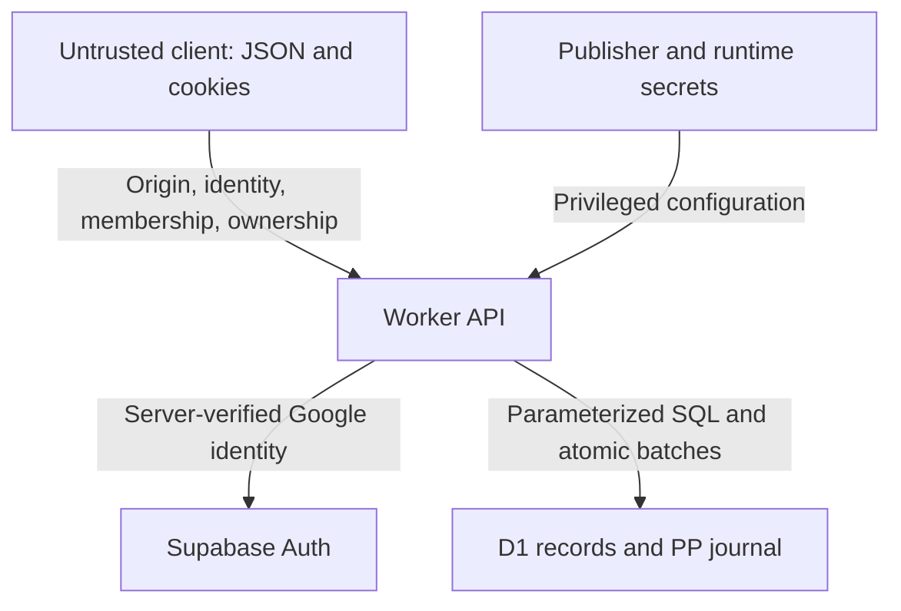

# Side Quest Ledger: threat model and security assessment

**Release update — October 21, 2026 (Pacific):** Sites version 15 retains verified Google identity, group membership, server-side ownership, owner-bound admin access, an immutable PP journal, atomic/idempotent mutations, origin checks, bounded input/results, rate counters, and audited recovery. The current trust-boundary section below reflects these changes. The October 13 findings elsewhere in this document are historical findings and acceptance criteria; they are not a current vulnerability assessment of version 15. No claim of a security-hardened or penetration-tested deployment is made.

Current verification: 128 domain checks, 12 authorization checks, 11 isolated local API checks, TypeScript and production build passed. Ordinary and anonymous users were denied admin reads/mutations; a caller-supplied admin role could not authorize a balance adjustment. Local browser checks confirmed route denial. Current verified email is checked against both stored membership email and configured owner. See [MEMBER_RELEASE.md](../MEMBER_RELEASE.md) for implementation evidence and limits.

Still unverified: provider/session revocation behavior, distributed rate-limit/load behavior, effective hosted CSP/framing policy, recovery RPO/RTO, dependency/security scanning, and full multi-user production review/market flows. The group quiz is an enrollment gate, not a secret credential; friends know its answers. The finite-state checker covers only the earlier prototype.

Historical assessment date: 2026-10-13. Baseline: application behavior described in [FORMAL_MODEL.md](FORMAL_MODEL.md), GitHub application commit `1c20d8ccad8d9a2608b3ea3ec30c820e1d463f2e`, Sites source commit `a64da21e0fd5ab0a1bcd4680220b94c4a7f73610`.

**Historical assessment conclusion:** the October 13 application is a shared-access prototype. It does not establish individual identity, enforce per-user ownership, or provide robust session revocation. It is not ready to hold sensitive personal data or support adversarial users under the stated requirement that security is of utmost importance. This document identifies work; it does not implement that work or certify the deployment.

## 1. Method, evidence, and scope

Use STRIDE to inspect spoofing, tampering, repudiation, information disclosure, denial of service, and elevation of privilege. Use an asset/trust-boundary inventory and abuse traces to connect source behavior to consequences. Priorities are qualitative product decisions, not CVSS scores or penetration-test measurements.

Evidence classes:

- **Confirmed source behavior:** directly visible in named application files.
- **Observed historical validation:** build/type checks, positive live API tests on temporary records, and successful publication recorded during development.
- **Conditional risk:** exploitability depends on browser/hosting behavior, dependency vulnerabilities, stolen credentials, or operational controls not inspected.
- **Unknown:** provider account settings, effective response headers, logs, backups, rate limits, and recovery access have not been verified.

Review covered the board, auth/quest handlers, Drizzle schema/migrations, relevant Worker/hosting configuration, and unused platform identity helpers. It did not exhaustively audit the bundled component library, all build/connector integration code, provider internals, account administration, or every dependency. No malicious production testing, brute-force attempt, data extraction, or credential disclosure was performed. A public repository exposes implementation, not the live D1 data automatically.

## 2. Assets and desired guarantees

| Asset | Confidentiality / integrity / availability requirement |
| --- | --- |
| Names, quest text, rewards, participation and timestamps | Visible only to intended board members; actions attributable to an authenticated actor; no unauthorized modification/deletion |
| Runtime password and session secret | Never exposed in browser bundles, Git, logs, URLs, or docs; controlled rotation |
| Session credentials | Unpredictable, scoped, expiring, revocable; theft has limited lifetime and blast radius |
| D1 database and migration history | Least-privilege access, consistent writes, recoverable mistakes, bounded queries |
| Source and publication chain | Reviewed changes, protected credentials, reproducible build, dependency provenance |
| User experience and trust | Clear distinction between display name and verified identity; no misleading ownership or recovery promises |
| Logs and backups | Minimized personal data; restricted access; useful evidence without leaking credentials |

Quests can contain real locations, schedules, social relationships, or other personal details even if the intended product is casual. The current model stores these as free text and has no classification or field-level access policy.

## 3. Attacker capabilities

| Attacker | Capability | What is not assumed |
| --- | --- | --- |
| Internet visitor | Reach public login/page endpoints; inspect public source; send arbitrary requests | Does not initially know runtime secrets or have a valid token |
| Board-key holder / admitted participant | Read all quests; send arbitrary JSON; choose any name; issue any admitted quest operation | No user/admin distinction exists to limit this actor |
| Stolen-token holder | Replay an auth token from another environment | Does not need the board password once token is possessed |
| Malicious website | Attempt cross-origin requests or framing of the board | Cannot ordinarily read cross-origin responses or bypass browser cookie policy |
| Same-origin malicious script | Read/modify localStorage and perform authenticated requests | HttpOnly prevents directly reading the session cookie, but does not stop using it in requests |
| Compromised developer/dependency/publisher | Alter source or build output; potentially affect runtime | Not assumed already compromised; impact can be critical if it occurs |
| Operator mistake | Publish unintended code, rotate configuration incorrectly, apply a faulty migration | Not malicious; still a realistic integrity/availability threat |

## 4. Trust boundaries and attack surface

The browser cannot grant roles by changing its name, local state, requested member ID, or an admin flag. Supabase `getUser` validates the identity; Google provider identity and confirmed email are required. Application membership and role checks run in the Worker for every protected request. `/api/admin` and all `admin_*` actions enforce authorization; hiding navigation is not the control. The `/admin` UI waits for the protected API and shows an access-only state to ordinary members.

Public sign-in/callback endpoints establish a provider session; enrollment separately grants membership. `/api/me`, `/api/register`, `/api/board`, `/api/actions`, and `/api/admin` have distinct guards. Legacy `/api/quests` mutations are retired. `/api/media` and media reads are disabled without both the explicit feature flag and storage binding. Supabase Auth holds authentication data; D1 holds application records. Object storage is not provisioned. Secrets remain runtime-only and source publication does not expose live database contents.

Account deletion requires a verified Google caller, same-origin JSON and typed confirmation in the Worker. The Supabase function performs live JWT authentication itself (gateway `verify_jwt: false`), checks closure through the fixed authenticated Worker endpoint, then globally revokes sessions and removes only that caller. The runtime admin key remains in Supabase. D1 closes membership first, with atomic obligation checks and compensating PP events; provider failures leave a closed profile with an idempotent retry. Shared history and a secret email HMAC claim remain. This is not full content erasure, and real-provider deletion/revocation has not been tested on a production user. Rotating the HMAC secret can invalidate repeat-grant recognition. See [ACCOUNT_DELETION.md](../ACCOUNT_DELETION.md).

Third-party origins, same-origin malicious scripts, compromised sessions/dependencies, provider administration, and publication credentials remain separate threat surfaces. HttpOnly cookies and origin checks do not protect against all same-origin script or publisher compromise. GitHub push and Sites deployment remain independent authority boundaries.

## Historical assessment details

Sections 5–11 retain the October 13 prototype findings. Controls listed there must not be mistaken for an inventory of the current release.

## 5. Controls actually present

| Control | Evidence | Scope / limitation |
| --- | --- | --- |
| Server admission guard on every quest method | `guard()` in `app/api/quests/route.ts` | Shared admission only; no per-record ownership |
| Runtime-only auth configuration | `lib/auth.ts` imports Worker env | Source names the variables; configuration entropy/access not audited |
| Secure, HttpOnly, SameSite=Strict cookie | `sessionCookie()` | Useful browser protections; no server expiry or revocation |
| Parameterized Drizzle query construction | Quest route predicates and insert/update API | Reduces SQL injection exposure; not an authorization policy |
| Text rendering through JSX | `app/page.tsx` | No raw-HTML board sink identified; dependencies and future sinks remain relevant |
| Length trimming and category/action allowlists | Quest handlers | Partial validation; does not validate runtime types, total body size, or all numeric semantics |
| FK and exact-name uniqueness declarations | `db/schema.ts`, migration SQL | No authenticated user linkage; case ambiguity and race errors remain |
| No-store on quest GET and auth responses | API response headers | Mutation responses have no explicit no-store; browser memory may retain records after logout |
| Versioned migrations and runtime file ignore rules | `drizzle/`, `.gitignore` | GitHub export excluded generated artifacts; original Sites history contains generated archives |

## 6. Risk register

Priority: **P0** blocks a claim of strong security or sensitive-data use; **P1** should be addressed before broader exposure; **P2** is defense-in-depth or an operational gap needing measurement. Likelihood labels assume public hosting and ordinary admitted users, not a proven attack history.

| ID | STRIDE | Finding / location | Likelihood × impact | Priority |
| --- | --- | --- | --- | --- |
| T01 | S, E, I | Easily guessed shared key selected during prototyping; no app-level login throttle visible | High × High | P0 |
| T02 | S, T, R, E | PATCH trusts submitted `name`; POST trusts `createdBy`; no individual principal | High for admitted user × High | P0 |
| T03 | T, E | DELETE permits any admitted requester to delete any quest and its participants | High for admitted user × High | P0 |
| T04 | S, E | Deterministic board-wide token; no server expiration, per-session revocation, or logout invalidation | Conditional token theft × High | P0 |
| T05 | D | Unbounded GET, no pagination, unrestricted admitted writes, no verified quotas/throttles | Medium × High | P1 |
| T06 | T, D | Non-atomic select/write/legacy reconciliation and two-statement deletion | Medium × Medium/High | P1 |
| T07 | S, T | UI lowercase identity versus exact SQL key; name collisions and rename ambiguity | High × Medium | P1 |
| T08 | D, I | Runtime type/JSON/cookie validation gaps; errors can throw unexpectedly | High × Medium | P1 |
| T09 | T, E | No explicit origin/Fetch Metadata/CSRF validation; handlers accept JSON without enforcing media type | Conditional × High | P1 |
| T10 | I, T | Effective CSP, frame protection, security headers and script restrictions unverified | Conditional × High | P1 verification |
| T11 | R, T | No actor-bound audit trail, soft deletion, restore workflow, or application rollback evidence | High after incident × High | P1 |
| T12 | I | All admitted clients receive all board data; browser snapshot/name persist outside authenticated ownership | High × Medium/High | P1 |
| T13 | E, T, I | Dependency/build/publisher compromise; broad inherited framework surface | Conditional × Critical | P1 operational |
| T14 | T, D | Legacy migration/linking errors or unsafe ownership backfill | Medium × High | P1 |
| T15 | D, I | Storage denial or reload failure can leave client on loading screen; no tested fail-safe UI | Medium × Medium | P2 |

The current key's value is intentionally omitted from public documentation. No exploit depends on it being a source-code constant; the risk is its deployed strength and shared scope. Provider-level protections may reduce T01/T05, but cannot be credited without evidence.

## 7. Detailed abuse cases and mitigations

### T01: weak shared admission and online guessing

**Trace:** an outsider sends password guesses to public login. A correct guess returns the common token. Every board operation is then available. Login handler has no attempt counter, rate limiter, lockout/backoff, or per-user account boundary.

**Required response:** use a strong unique temporary board key and app/edge throttling while transitioning to verified identity and membership. Measure rate-limit behavior, including distributed requests. Do not reveal the real key in docs or tests. Store secrets in runtime configuration; rotate on suspected disclosure. Anonymous-device identifiers are not a substitute for membership.

**Acceptance:** isolated tests show failed attempts become bounded, allowed logins still work, no value appears in client/build/log artifacts, and an outsider cannot create/read/mutate board records without the chosen membership policy. Key hardening alone leaves T02-T04 unresolved.

### T02/T03: identity spoofing, false attribution, and unrestricted deletion

**Trace:** an admitted client sends PATCH with another person's visible name, completing or removing that person's participation. The same client can create a quest with another creator label or delete a quest it did not create. The UI's name prompt and confirmation dialog do not constrain direct API access.

**Required response:** bind participation and creator ownership to an immutable server-derived user ID. Enforce board membership and per-operation creator/participant/admin policy on the server. Keep names as display attributes. Decide explicitly whether a shared-admin board is acceptable; it is incompatible with claiming personal ownership enforcement.

**Acceptance:** user A cannot create as B, change B's participation, or delete B's quest unless granted an explicit admin permission. Tampered names, IDs, and caller-supplied identity headers do not change principal. Legacy records are unowned or linked through a verified procedure, never automatically claimed by matching text.

### T04: replayable shared sessions

**Trace:** two visitors receive the same token. One copied token remains valid after logout because only the browser cookie is expired. Replaying it after 30 days remains valid while password/secret configuration is unchanged; the server checks no expiry.

**Required response:** prefer supported platform identity and its verified session lifecycle where appropriate. If app-owned sessions are necessary, use cryptographically random opaque IDs with hashed server storage, user linkage, explicit expiry, revocation, rotation, and narrow authorization. Validate cookie format safely and consider a host-prefixed name. Do not patch the digest with custom cryptography and call it equivalent to revocable sessions.

**Acceptance:** distinct sessions differ; expired/revoked credentials are rejected server-side; logout revokes the relevant session; rotating one user's session does not require disrupting everyone. Incident response can revoke sessions without losing records.

### T05: resource exhaustion

**Trace:** an admitted client creates many quests or many unique participant names. GET fetches every quest and participant, then filters the participant collection for each quest: roughly `O(|Q| * |R|)` assembly plus an unbounded response. Outsiders can also pressure auth parsing/token generation. Worker/provider limits are failure ceilings, not application quotas.

**Required response:** body caps before parsing, authenticated per-actor quotas, edge/application rate limits, bounded cursor pagination, indexed scoped queries, one-pass grouping, request time/error budgets, and alerts. Avoid unlimited participant creation behind a shared key.

**Acceptance:** oversized bodies are rejected without writes, reads have a defined maximum size and stable pagination, burst tests use an isolated environment, and quota-denied requests cannot partially mutate data. Load measurements define a capacity target rather than assuming “serverless” means unlimited.

### T06/T07/T14: races, name ambiguity, and legacy data

**Trace:** concurrent claims both select no exact participant; one insert succeeds and the other errors. `Alex` and `alex` both exist in D1 while UI treats them as the same person. Deletion can commit participant removal and then fail quest deletion. A name-based backfill may assign an old participant's record to an unrelated account.

**Required response:** immutable user keys, explicit canonicalization of display names only where needed, atomic upsert/conditional transitions, supported D1 batch operations for multi-write units, version/conflict policy, and staged append-only migrations with reconciliation reports. Keep existing claim history through a deliberate legacy conversion.

**Acceptance:** a concurrent duplicate operation has a documented deterministic response, all-or-nothing deletion survives injected failures, another participant's state is unchanged, and migration fixtures cover empty creators, legacy claims, completed legacy records, duplicate/case/Unicode names, and deleted quests. Do not use a read followed by a write as an ownership lock.

### T08: malformed inputs and exception behavior

**Trace:** a JSON field asserted as a string is actually numeric or object-valued, then `.trim()` throws. Malformed JSON can reject parsing. Invalid percent encoding in the session cookie can throw before the intended 401. Fractions and coercible numeric strings pass some numerical handling despite integer-oriented UI/schema.

**Required response:** shared runtime schemas; require a plain object and correct field types; validate positive integer IDs and finite integer points; bounded lengths/body size; safe cookie parsing; consistent generic 400/401/413 responses; internal sanitized error logging. Treat unexpected D1 errors separately from client validation.

**Acceptance:** null, arrays, numbers, oversized text, malformed JSON, malformed cookies, zero/negative/fractional IDs and nonfinite/coercible points have explicit outcomes and no unhandled exceptions or database changes. A TypeScript type assertion is not a validation result.

### T09: CSRF and origin assumptions

**Evidence:** cookie is SameSite=Strict; no explicit origin checks or CSRF tokens; request JSON is parsed without enforcing Content-Type. CORS headers are not explicitly opened by these handlers. These existing browser defenses substantially constrain ordinary cross-site authenticated attacks.

**Conditional trace:** a hostile same-site context, misconfigured proxy/CORS setting, browser variation, or future cookie-policy change permits credentials on an unintended request. Login/logout also deserve origin checks despite different admission semantics. This is an unresolved boundary, not a claim that arbitrary cross-site deletion currently succeeds. The Sites hostname's effective site boundary/PSL behavior was not tested.

**Required response:** define the production origin, validate Origin and appropriate Fetch Metadata on state changes, enforce intended JSON media type, and choose framework-supported CSRF controls. Document treatment of legitimate non-browser clients and missing headers. Do not weaken SameSite for convenience without revisiting the model.

**Acceptance:** isolated hostile-origin requests fail before mutation; legitimate clients succeed; same-site versus same-origin and proxy normalization are explicitly tested. Logout does not allow unwanted cross-origin session changes under the chosen policy.

### T10/T12: browser compromise and data exposure

Current text interpolation reduces direct stored-XSS exposure. No raw-HTML renderer was identified. Nevertheless, a compromised dependency or future unsafe HTML/link feature could execute on-origin and send authenticated requests despite HttpOnly. Effective CSP, clickjacking protection, Referrer-Policy, nosniff, HSTS, and platform-injected headers were not measured.

All admitted visitors receive all content and names. Logout hides the board but does not explicitly clear the React quest snapshot or saved name. Cache no-store does not erase application memory, browser extensions, screenshots, downloaded data, or D1 records. Shared devices and visible personal schedules require a retention/privacy policy.

**Required response:** verify effective headers and add compatible policy where missing; test CSP against hydration and current inline styling; restrict framing; keep text-only content; minimize stored personal details; clear sensitive client snapshots on logout where appropriate. Decide whether all-member visibility is acceptable before promising confidentiality.

**Acceptance:** a browser security-header check is recorded; no inline policy bypass is added without justification; rendered malicious text remains text; framing is blocked according to policy; logout behavior and shared-device expectations are documented. No dependency CVE status is asserted without an actual scan.

### T11/T13: operations, recovery, and supply chain

There is no application audit log binding events to authenticated users; no soft deletion or user restore action; no measured recovery drill. D1 offers platform recovery capabilities, but plan-specific retention and the operator's ability to use them are unknown. Repository dependency pinning/lockfile exists; protected branches, required review, secret scanning, security advisories, CI, deployment permissions and rollback capabilities have not been verified.

**Required response:** minimize and protect actor-bound audit events; soft-delete where policy requires recovery; maintain tested database exports/recovery procedures; protect GitHub/Sites credentials and least-privilege permissions; use reviewed builds, dependency scanning, secret scanning, and change approvals. Document code rollback separately from schema/data recovery.

**Acceptance:** recovery from a synthetic deletion is demonstrated in isolation; RPO/RTO and retention are owner-approved; security events can be correlated without logging secrets or full private payloads; a source change cannot reach production without the intended publication controls. Verify D1 plan/access rather than promise a specific recovery window.

## 8. Recommended implementation sequence

| Phase | Work | Exit criterion |
| --- | --- | --- |
| A: contain public risk | Stronger temporary shared admission, verified throttling, restricted destructive operations, runtime secrets and header review | Key guessing/bulk deletion risk reduced; no assertion of personal identity yet |
| B: establish principal | Choose supported authenticated identity, board membership, immutable users, ownership/admin policy, revocable session semantics | T02-T04 acceptance cases pass; legacy association explicitly handled |
| C: constrain mutations | Runtime schemas, CSRF/origin policy, atomic SQL, explicit state preconditions, conflict handling, pagination/quotas | Negative/concurrent cases fail safely and predictably |
| D: operate and recover | Audit, retention, restore drill, monitoring, CI/dependency/secret checks, publication access review | Evidence recorded; remaining risk accepted explicitly |

This is a proposed sequence, not a completed roadmap or authorization to change runtime behavior. Every identity/recovery/admin UX decision must involve the design principal under [AGENTS.md](../AGENTS.md). Security requirements may rule out an unsafe interaction, but they do not justify secretly adding a new one.

## 9. Security verification matrix

Use an isolated environment with user A, user B, an administrator, an outsider, synthetic quests, and unique credentials. Preserve fixtures or backups before destructive tests.

| Test family | Required evidence |
| --- | --- |
| Admission | Missing, malformed, expired, revoked and valid session cases; no DB effects on rejection |
| Ownership | Forged names/creator IDs, other-user resource IDs, member/nonmember/admin matrix |
| State machine | Complete-before-claim policy, duplicate complete, reopen/unclaim, multiple independent participants |
| Races | Simultaneous join, complete/reopen collision, delete/update collision, migration concurrency |
| Input limits | Body cap, bad JSON/types, string boundaries, Unicode/case, positive IDs, finite integer points |
| Browser policy | Effective cookies/headers, CSRF/origin enforcement, literal text rendering, localStorage denial/clear, logout data handling |
| Availability | Bounded response size, quotas, rate limits, retry budget, measured query/worker load |
| Operations | Audit redaction, secret/build scan, code rollback, migration failure, data restore drill |

Current positive API checks demonstrate basic happy paths only. The finite-state checker demonstrates model invariants and expected counterexamples only. Neither proves that this matrix passes in production.

## 10. Incident handling and open decisions

On suspected unauthorized activity: notify the operator, preserve minimized evidence, contain access through supported controls, rotate compromised credentials, assess exposed records, and determine whether a code fix, data restore, or both are needed. Do not publish incident payloads or user records to the public repository. Current token containment requires configuration rotation because per-session revocation does not exist.

Before production hardening, the owner must decide: who may join the board; whether anonymous participation remains; how legacy records acquire owners; who can delete/moderate; whether repeat completions preserve history; what data is acceptable; how account/device recovery works; and what operational retention/recovery targets are required. No risk acceptance is inferred from past prototype convenience choices.

## 11. Primary references

Accessed 2026-10-13; recommendations are paraphrased and applied to this source, not copied as a certification checklist.

- [OWASP Threat Modeling](https://cheatsheetseries.owasp.org/cheatsheets/Threat_Modeling_Cheat_Sheet.html)
- [OWASP Authentication](https://cheatsheetseries.owasp.org/cheatsheets/Authentication_Cheat_Sheet.html)
- [OWASP Authorization](https://cheatsheetseries.owasp.org/cheatsheets/Authorization_Cheat_Sheet.html)
- [OWASP Session Management](https://cheatsheetseries.owasp.org/cheatsheets/Session_Management_Cheat_Sheet.html)
- [OWASP Input Validation](https://cheatsheetseries.owasp.org/cheatsheets/Input_Validation_Cheat_Sheet.html)
- [OWASP CSRF Prevention](https://cheatsheetseries.owasp.org/cheatsheets/Cross-Site_Request_Forgery_Prevention_Cheat_Sheet.html)
- [OWASP XSS Prevention](https://cheatsheetseries.owasp.org/cheatsheets/Cross_Site_Scripting_Prevention_Cheat_Sheet.html)
- [Cloudflare D1 atomic batch API](https://developers.cloudflare.com/d1/worker-api/d1-database/)
- [Cloudflare D1 Time Travel](https://developers.cloudflare.com/d1/reference/time-travel/) and [plan limits](https://developers.cloudflare.com/d1/platform/limits/)
- [MDN cookie attributes](https://developer.mozilla.org/en-US/docs/Web/HTTP/Reference/Headers/Set-Cookie)
